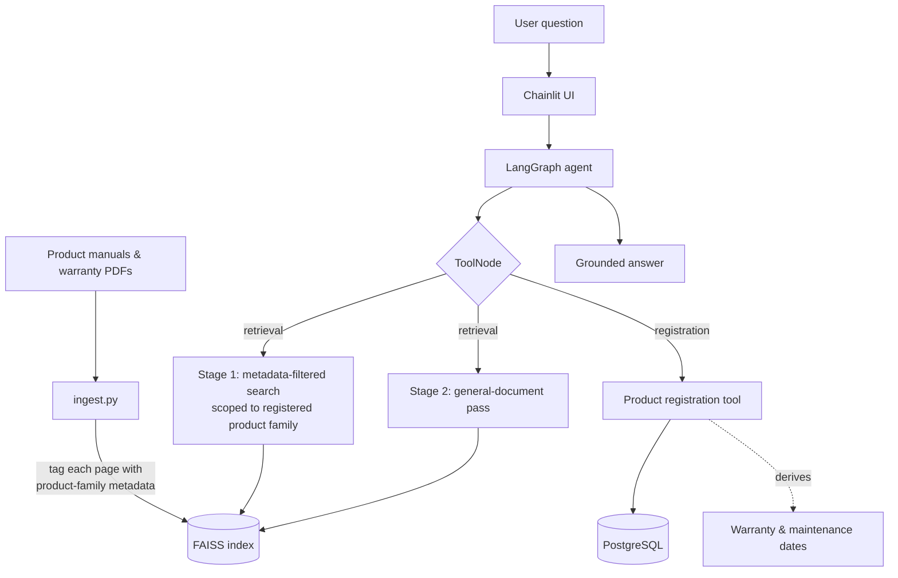

# Fissler AI Support Assistant — Agentic RAG for Technical Support

A tool-calling support agent that answers customer questions **strictly from official product
manuals and warranty documents**, so it cannot invent an answer about a product it has not read.

Built on LangGraph with a two-stage retrieval strategy that keeps one product model's
documentation from leaking into another model's answer.

---

## The problem it solves

A generic RAG assistant over a manufacturer's document set fails in a specific way: the user
owns a *Vitavit Premium* pressure cooker, but the retriever surfaces a passage from the
*Vitaquick* manual because the wording is similar. The answer sounds confident and is wrong —
which for warranty and safety instructions is worse than no answer.

This project treats that as the core design constraint rather than an edge case.

---

## Architecture



### Design decisions worth explaining

**Two-stage retrieval.** Every query runs two passes: a metadata-filtered search restricted to
the product family the user actually registered, and a general pass over shared documentation
(safety, warranty terms). The filtered pass is what prevents cross-model answer bleed; the
general pass is what stops the agent going blind on questions that are not model-specific.

**Metadata is assigned at ingestion, not inferred at query time.** `ingest.py` tags every page
with its product family *before* chunking and embedding. Trying to infer the product from the
chunk text at retrieval time is unreliable — the model name often does not appear on the page
that contains the answer.

**Tool calling instead of prompt stuffing.** Product registration is a real tool that writes to
PostgreSQL and derives warranty and maintenance dates from the purchase date. The agent decides
when to call it; the dates are computed in code, not generated by the model.

**The index is rebuilt at container start.** The Dockerfile runs `ingest.py` before starting the
server, so a deployment always serves an index that matches the documents in the image. No
stale-index drift between environments.

---

## Tech stack

| Layer | Choice |
|---|---|
| Agent | LangGraph (`StateGraph` + `ToolNode`) |
| LLM & embeddings | OpenAI via `langchain-openai` |
| Vector store | FAISS |
| API | FastAPI, with Chainlit mounted for the chat UI |
| Database | PostgreSQL (psycopg2) |
| Ingestion | pypdf |
| Deployment | Docker |

---

## Layout

```
main.py         FastAPI app: onboarding page, registration endpoint,
                mounts the Chainlit chat
app.py          LangGraph agent: state, tools, retrieval, graph wiring
ingest.py       PDF → product-family metadata → chunks → FAISS index
belgeler/       source manuals and warranty documents
faiss_index/    generated vector index
static/         onboarding front-end
Dockerfile      builds index at start, then serves on :10000
```

---

## Running locally

```bash
pip install -r requirements.txt
cp .env.example .env         # OPENAI_API_KEY, SUPABASE_URL (PostgreSQL)

python ingest.py             # build the FAISS index from belgeler/
uvicorn main:app --reload    # onboarding + mounted Chainlit chat
```

Or with Docker, which does both steps in one:

```bash
docker build -t fissler-ai .
docker run -p 10000:10000 --env-file .env fissler-ai
```

---

## What I would change next

- Add a retrieval evaluation set — question, expected source page — so changes to chunking or
  the filter can be measured instead of eyeballed.
- Cache embeddings between ingest runs; today a rebuild re-embeds every page.
- Return source page citations in the UI so a support agent can verify the answer against the
  manual in one click.
